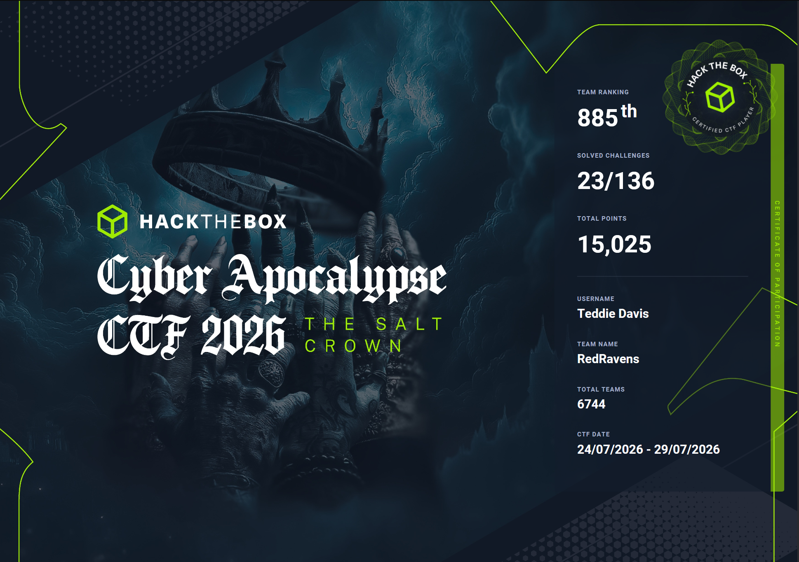

# Cyber Apocalypse CTF 2026: The Salt Crown

**Organization:** Hack The Box - Community

**Starts At:** 2026-07-24 13:00

**Ends At:** 2026-07-29 13:00

## About the Event
When High King Maelor tried to steal the realm's oldest vow, white fire scoured him from existence. The Brine Signet—the sovereign artifact that made royal decrees absolute—shattered into wandering fragments. Trust has collapsed, and Valyssar is bleeding.

This is no longer a war of blades; it is a war of infrastructure, logic, and counterfeit governance. While ambitious lords weaponize forged paperwork and buy off city checkpoints , a far more terrifying threat marches from the fog: the Quiet Marches. Led by the enigmatic Alyss, this mindless "Hollow Host" utilizes a highly synchronized, unbreathing cadence to process entire villages into silent compliance.

The endgame is not a throne of absolute power, but the creation of The Salt Crown—a fault-tolerant constraint system designed to put a permanent leash on authority.
The system will only empower a leader who accepts the leash. Secure the chain, or inherit the ruins.

## Challenges

| Title | Category | Difficulty | Solved | Writeup |
| --- | --- | --- | --- | --- |
| Mement0 | AI - ML | easy | :heavy_check_mark: |  |
| Caldrin's Day Away | Blockchain | easy | :heavy_check_mark: |  |
| Three Tankards and a Lie | Coding | very easy | :heavy_check_mark: |  |
| False Witness | Crypto | very easy | :heavy_check_mark: |  |
| Fractured Seal | Crypto | easy | :heavy_check_mark: |  |
| The Ashen Field | Crypto | very easy | :heavy_check_mark: |  |
| Force Push | Forensics | very easy | :heavy_check_mark: |  |
| The Compressed Truth | Forensics | very easy | :heavy_check_mark: |  |
| The Ledger Beneath the Hull | OSINT | easy | :heavy_check_mark: |  |
| The Raven That Landed Twice | OSINT | very easy | :heavy_check_mark: |  |
| RINg the Bell | Pwn | very easy | :heavy_check_mark: |  |
| The Hinge Whisper | Pwn | very easy | :heavy_check_mark: |  |
| Cinderbound | Reversing | very easy | :heavy_check_mark: |  |
| Ringtrue | Reversing | very easy | :heavy_check_mark: |  |
| Hollow Courier | Secure Coding | easy | :heavy_check_mark: |  |
| Gatery | Web | very easy | :heavy_check_mark: |  |
| Massagold | Web | very easy | :heavy_check_mark: |  |

Certificate of Completion  
