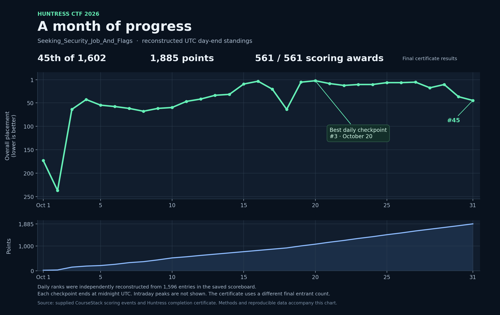
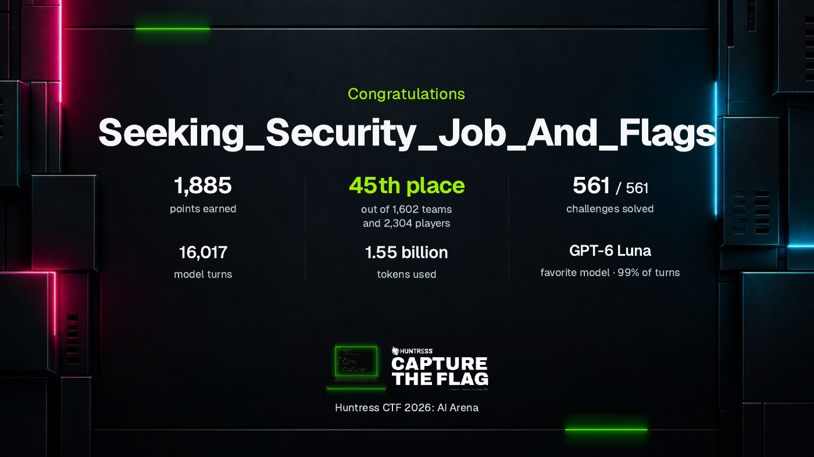

# Huntress CTF 2026: AI Arena

**Seeking_Security_Job_And_Flags · 45th of 1,602 teams · 1,885 points**

This is my record of Huntress CTF 2026: the challenges, the AI-assisted workflow I developed during the month, the retained solver code, and the results. Work moved between Codex, the event's Homebase AI, and ChatGPT. The collection preserves both useful technical investigations and the limits of the evidence that survived the event.

> **AI authorship and verification**
>
> The writeups, tool documentation, summaries, and data presentations in this collection were generated using AI, drawing on retained challenge artifacts, logs, solver code, and saved results. The material was subsequently organized and reviewed for publication.
>
> AI can produce factual errors, unsupported assumptions, and incorrect interpretations, even when stated confidently. The checks documented here cover specific aspects of the collection; they do not establish that every technical claim is correct or every solve has been independently reproduced.
>
> Before relying on an explanation, command, code sample, or reported result, verify it against the underlying artifacts and source evidence, and reproduce the relevant steps where possible. Known gaps and verification limits are documented throughout the collection.

## Results

| Measure | Result | Evidence |
| --- | --- | --- |
| Final placement | **45th of 1,602 teams** | [Completion certificate](assets/huntress-ctf-2026-certificate.pdf) |
| Final score | **1,885 points** | Certificate and [saved scoring results](results/README.md) |
| Completion | **561 / 561**, as labeled on the certificate | 558 daily mode awards plus three scored extras |
| Daily challenges | **186 across six lanes**, with all three scoring modes recorded | [Complete challenge catalog](writeups/README.md) |
| Best reconstructed daily placement | **3rd on October 20** | [Daily scoring reconstruction](results/README.md) |

The certificate counts individual mode completions. It does **not** mean 561 distinct named challenge writeups. The saved catalog contains 186 daily challenges, three scored extras, and an unscored Sanity Check. An award in the mode called Time Trial or Mastery does not by itself establish a ranked Hall of Fame run.

The chart uses the end of each **UTC** day and reconstructs placement from the retained scoreboard. It is not a series of official daily leaderboard screenshots or a measurement of the best rank reached within each day. The final result above uses the certificate's 1,602-team count; the saved scoreboard has 1,596 entries. [Calculation, source differences, and downloadable data](results/README.md).

## Start here

| Section | What it contains |
| --- | --- |
| [Challenge catalog](writeups/README.md) | Every named task in the saved roster, with links to available accounts and clear gaps where only scoring evidence remains |
| [SHA1-Hulud](writeups/day-30/sha1-hulud.md) | A detailed reverse-engineering account, including the shift away from unsuccessful hash guesses and the limits of the retained successful-solve record |
| [AI workflow](AI_WORKFLOW.md) | How category-specific prompts, reusable solvers, replay checks, and credit management fit together |
| [Final prompt snapshots](prompts/README.md) | The six category prompts and the separate review/training prompt used near the end of the event |
| [Solver tools](tools/README.md) | Preserved early and later tooling, with historical platform dependencies explained |
| [Results and placement](results/README.md) | Certificate-backed results, scoring timestamps, daily placement, and reproducible calculations |
| [Source notes](source-notes/README.md) | Earlier notes and later session accounts behind the edited articles |
| [Authorship and evidence](ABOUT.md) | AI attribution, editorial changes, and what was and was not verified |

## Reading the writeups

The depth of the retained material varies. Some articles contain detailed investigations; others are short session notes or evidence-limited summaries. A short account is labeled accordingly. The catalog also records completed challenges for which no dedicated walkthrough was recovered.

Historical notes can show an unsuccessful attempt before a later completion. The final scoring data is kept separate so an old progress note is not mistaken for the final outcome. Original command examples describe their event workspace; the current package does not recreate the retired event services or every downloaded challenge artifact.

## Certificate

The certificate also reports 16,017 model turns, 1.55 billion tokens, and GPT-6 Luna as the favorite model at 99% of turns. These are platform-reported event statistics, not an estimate of personal API spending.

Challenge names and event materials belong to their respective creators. This repository is a participant's collection of notes and code, with AI assistance disclosed. See [attribution](ATTRIBUTION.md).
