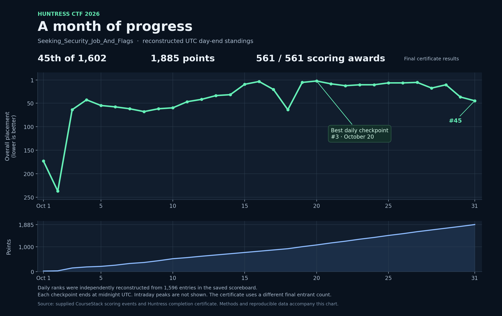

# Results and scoring evidence

**Seeking_Security_Job_And_Flags finished 45th of 1,602 teams, with 1,885 points and all 561 scoring awards completed.** Those final totals come from the supplied Huntress completion certificate, which also lists 2,304 players. The certificate calls the awards “challenges solved”; the saved question catalog shows how that count is composed.



Download [the standalone interactive chart](placement.html) and open it in a browser to inspect any day, switch between placement and points, or export the daily CSV. It works offline. GitHub's normal file view displays the HTML source; it does not run this chart. The [SVG](../assets/team-placement.svg) is available for scalable display or reuse.

## What was completed

| Scoring component | Named tasks | Awards per task | Points |
| --- | ---: | ---: | ---: |
| Daily tasks across six lanes | 186 | 3 | 1,860 |
| Read the Rules | 1 | 1 | 10 |
| Welcome Robots | 1 | 1 | 10 |
| SHA1-Hulud | 1 | 1 | 5 |
| **Total scored** | **189** | **561 awards total** | **1,885** |

Each daily task has Single Solve (2 points), Time Trial (3 points), and Mastery (5 points). The data records 186 awards in each mode. Sanity Check is an additional orientation record with no point value; its completion cannot be inferred from a scoring award.

The [complete challenge catalog](challenge-catalog.json) contains all 190 distinct lesson records, including that unscored orientation item. This is a completion inventory. A score record alone does not supply a saved solver or a walkthrough, and a missing article does not mean the task was unsolved.

The catalog preserves two day fields: `lane_day` comes from the question identifier, while `release_day` comes from its CourseStack chapter. These differ for some web tasks. For example, Framework Roulette is `web_exploitation_day_30_framework_roulette` but appears in the Day 31 chapter. Renaming it solely from one field would lose useful context.

## Three different participant counts

| Source | Placement | Denominator | How to use it |
| --- | ---: | ---: | --- |
| Completion certificate | 45th | 1,602 teams | Official final result; certificate also lists 2,304 players |
| Supplied `scoreboard.json` | 45th | 1,596 entries | Source for the scoring events and reconstructed daily rankings |
| Earlier AI-created chart | 45th | Says 1,590 entries | Earlier visualization, checked against the supplied scoreboard |

The files do not establish why these totals differ. The saved JSON includes 1,201 `solo` entries and 395 `team` entries; 16 entries are marked deleted. These categories do not explain the difference from the certificate, so no adjustment has been invented.

The latest scoring event anywhere in the saved JSON is **2026-11-01 00:51:18.723 UTC**. That is an event timestamp, not the export time. The export itself has no recorded capture timestamp. This team's final scoring event is SHA1-Hulud at **2026-10-31 15:32:27.237 UTC**.

## Daily placement method

The chart reconstructs one checkpoint for each October calendar day:

1. Include all 1,596 entries retained in the supplied scoreboard.
2. For each entry, select its latest scoring event strictly before 00:00:00 UTC at the start of the following day. This includes every millisecond of the selected date and excludes the next date.
3. Sort by cumulative points descending, then by the latest scoring-event timestamp ascending.
4. Resolve any remaining exact tie with a stable anonymous entry identifier. No remaining exact tie affects this team's 31 published ranks.

The same midnight cutoff is used for October 31; later November 1 events are excluded from that day's checkpoint. The team's October 31 rank and full saved-snapshot rank are both 45.

**The best reconstructed daily checkpoint is 3rd on October 20.** This is not a claim that 3rd was the highest intraday placement. The dataset has not been used here to report intraday peaks. UTC midnight also differs from the user's local end of day, so a screenshot taken in the evening can show a different placement without contradicting this chart.

This is a reconstruction from retained scoring events, not an official archive of daily leaderboard pages. Historical account membership, moderation changes, or removed scoring history cannot be recovered from this snapshot. Excluding the 16 entries currently marked deleted does not change this team's published daily ranks.

### Review of the original AI-created chart

All **31 team rank/score pairs** in the original HTML match the independent reconstruction from the supplied scoreboard. The team's line was supported by the data.

Some captions were stale: it said 1,590 entries, described 49 teams above a team in 45th place, and elsewhere referred to 16 highlighted teams while embedding 50. Its cohort was the top 50: 44 entries above this team and five below. Other teams' final results also differ from the newer saved snapshot. The replacement chart uses only this team's verified series and separates the certificate's final totals from the snapshot's reconstruction denominator.

## Timestamps are not elapsed solve durations

The full [scoring-event CSV](team-scoring-events.csv) records when CourseStack awarded points, including milliseconds and the complete UTC date. It has all 561 awards. These are not stopwatch durations or necessarily the exact moment an artifact was first solved.

The supplied `Solve times.md` is a separate, partial Game Master record. It labels its times as first-solve UTC timestamps and includes only Days 1–29. Its 173 challenge rows contain 458 clock values and 61 blank cells. Of those blanks, 59 correspond to mode awards present in the later scoreboard; the remaining two are non-applicable timed modes on Welcome Robots. A blank in those notes therefore must not be published as an unsolved task.

The notes omit full calendar dates. For example, a challenge listed under Day 1 can have been solved on October 2 UTC. There is also an unresolved Welcome Robots discrepancy: the note says `19:41:58`, while the scoreboard awards its points at `2026-10-01T14:11:41.749Z`. Small differences occur between other first-solve clocks and point-award clocks. The files do not establish a cause, so the records have not been silently merged.

[The partial first-solve CSV](partial-first-solve-notes.csv) preserves both values where available. Use the complete scoring-event CSV for award chronology. No elapsed-duration claims are made from either source.

## Data files and reproduction

| File | Contents |
| --- | --- |
| [summary.json](summary.json) | Final certificate totals, saved-snapshot facts, limitations, and original file SHA-256 digests |
| [daily-placement.csv](daily-placement.csv) / [JSON](daily-placement.json) | The 31 plotted UTC checkpoints with rank, points, last scoring event, and cutoff |
| [team-scoring-events.csv](team-scoring-events.csv) | All 561 awards with task, lane, release day, mode, points, and UTC timestamp |
| [challenge-catalog.json](challenge-catalog.json) / [completion CSV](challenge-completion.csv) | All 190 distinct lesson records and their award status |
| [rank-inputs.json](rank-inputs.json) | Complete anonymized cumulative scoring timelines for all 1,596 entries |
| [reproduce_results.py](reproduce_results.py) | Standard-library Python script that recomputes and verifies every daily checkpoint |
| [partial-first-solve-notes.csv](partial-first-solve-notes.csv) | Partial clock-only notes alongside independently recorded point-award timestamps |
| [placement.html](placement.html) | Self-contained interactive report with embedded team data |

From the event directory, run:

```bash
python results/reproduce_results.py --verify
```

To write a fresh CSV elsewhere:

```bash
python results/reproduce_results.py --output recreated-daily-placement.csv
```

The script needs only Python's standard library and the included anonymized data. It makes no network requests and runs no challenge code. The data retains stable anonymous entry IDs, UTC scoring timestamps, and cumulative points. Other entrants' names, raw account IDs, question answers, and individual question identifiers are not required to reproduce the rankings and are omitted from that dataset. Only this team's name is retained.

## Validation and provenance

The source scoreboard contains **106,077 scoring events**. For every one of its 1,596 entries, the review checked that cumulative values equal the sum of prior awards, totals agree, the final timestamp matches `last_scored_at`, and question IDs do not repeat within the history. All checks passed. Recalculation from the anonymized public inputs reproduces every field of the daily CSV.

SHA-256 digests for the original scoreboard, first-solve notes, HTML chart, and certificate are recorded in [summary.json](summary.json). The original private workspace archives are not needed to reproduce this public daily-placement series.
